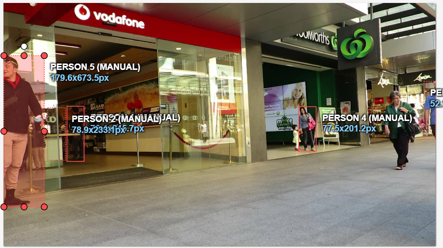
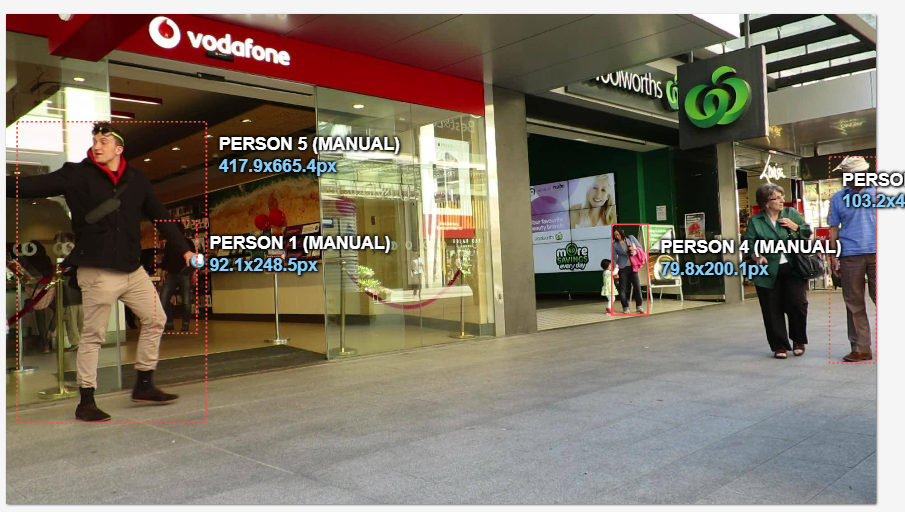
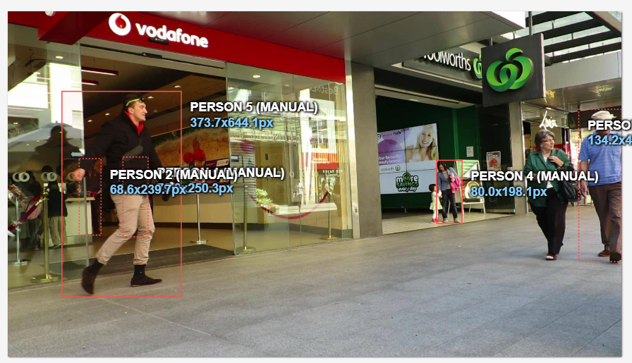

# Báo cáo cá nhân — HoVaTen-MSSV

Đổi tên file theo quy tắc `MSSV_HoTen.md`. Ví dụ: `20241234_NguyenVanAn.md`.

Đoạn video: MOT17-09, 150 frame (frame 1–150), nguồn MOTChallenge, giấy phép CC BY-NC-SA 3.0.

## 0. Thông tin học viên

- Họ tên: Nguyễn Hán Trường Giang
- MSSV: 2A202603112
- Mã đề (A/B/C): C
- Email: 26ai.giangnht@vinuni.edu.vn
- Link repository: https://github.com/giangnht29032004/K5-L2-DAY05-NguyenHanTruongGiang-2A202603112-MOTTracking
- Giờ bắt đầu: 16h30
- Giờ kết thúc: 18h05

## 1. Xem trước đoạn video (CP0)

Ghi **trước khi vẽ**, mỗi người một dòng.

| Mã | Frame xuất hiện | Frame cuối thấy được | Rẽ / dừng / đổi tốc độ ở frame | Bị che ở frame | Ghi chú |
|---|---|---|---|---|---|
| P1 |0 |149 |67 |0–9, 30–59, 100–119 |Có 3 đoạn occluded, tổng 60 frame |
| P2 |0 |97 |38 |0–19, 40–68, 87–97 |Có hai khoảng outside: 20–39 và 69–86 |
| P3 |10 |149 |68 |10–66 |Box tăng kích thước rõ khi người tiến gần camera |
| P4 |0 |108 |88 |100–108 |Người xuất hiện đến frame 108, sau đó outside |
| P5 |10 |138 |42 |10–39, 110–119, 130–138  |Có khoảng outside 120–129 |

## 2. Keyframe và thời gian (CP1, CP4)

Số keyframe lấy từ kết quả `src/check_submission.py`.

| Mã | Số keyframe | Keyframe ở frame | Số frame có mặt | Keyframe / 100 frame | Thời gian (phút) | Chỗ khó |
|---|---|---|---|---|---|---|
| P1 |17 |0, 10, 20, 30, 40, 50, 60, 70, 80, 90, 100, 110, 120, 129, 130, 139, 149 |150 |11.3 |10 |Xử lý các đoạn bị che một phần |
| P2 |21 |0, 10, 40, 50, 60, 61, 62, 63, 64, 65, 66, 67, 87, 88, 89, 90, 92, 93, 94, 95, 96 |60 |35.0 |10 |Có hai khoảng outside và cần giữ đúng ID khi xuất hiện lại |
| P3 |44 |10, 20, 30, 40, 50, 60, 67, 70, 71, 72, 80, 82, 83, 85, 86, 87, 88, 89, 90, 91, 92, 93, 94, 95, 100, 104, 105, 110, 111, 112, 113, 114, 120, 122, 123, 124, 125, 126, 127, 128, 129, 130, 140, 149 |140 |31.4 |10 |Box thay đổi kích thước nhiều, có đoạn occluded dài |
| P4 |10 |0, 10, 20, 30, 40, 50, 60, 80, 90, 100 |109 |9.2 |10 |Người nhỏ, box ít thay đổi, bị che ở đoạn cuối |
| P5 |12 |10, 20, 30, 40, 50, 60, 70, 80, 90, 100, 110, 130 |119 |10.1 |10 |Di chuyển ngang qua khung hình và có khoảng outside |
| **Tổng** |104 | |578 | | | |

Keyframe / 100 frame của cả bài = tổng keyframe ÷ tổng số frame có mặt × 100 = 18

Bạn đặt keyframe nhiều nhất ở người nào? Vì sao (người đó rẽ, dừng, lại gần camera hay bị che)?

P3 có số keyframe nhiều nhất với 44 keyframe, tương đương 31.4 keyframe / 100 frame. Qua các box trong file xuất, người này di chuyển từ phía bên phải sang trái và kích thước bounding box tăng rõ rệt khi tiến gần camera. Chiều cao box tăng từ khoảng 258 pixel ở frame 10 lên khoảng 864 pixel ở frame 140. Ngoài ra, người này có đoạn occluded từ frame 10 đến 66. Những thay đổi về kích thước và tình trạng che khuất khiến việc đặt keyframe cần được chú ý nhiều hơn.

## 3. Đoạn bị che (CP2)

Người bị che: `P1`

| Mốc | Frame |
|---|---:|
| Bắt đầu bị che một phần (bật `occluded`) |0 (đã bật từ frame đầu), 30, 100 |
| Mất hẳn (bật `outside`) |Không có |
| Hiện lại (tắt `outside`) |Không có |
| Thấy rõ trở lại (tắt `occluded`) |10, 60, 120|

- Thời gian khuất hẳn: Không.
- Quyết định: giữ cùng ID.
- Lý do (trả lời 3 câu: khuất bao lâu so với 60 frame, ngoại hình có khớp, chỗ hiện lại có đúng hướng và tốc độ):

Không bị khuất hẳn.

Ảnh chụp màn hình:





## 4. Tự review ID (CP3)

Lượt 1 theo người (đi ngược từ frame 149 về 0 trên CVAT), lượt 2 theo cảnh (nhảy 10 frame). Ít nhất 3 dòng; không có lỗi thì ghi một dòng "đã kiểm hai lượt, không lỗi".
Đã kiểm hai lượt, không lỗi.
Loại lỗi dùng đúng một trong 7 mã: `id_switch`, `fragmentation`, `lost`, `merge`, `false_track`, `drift`, `flag`.

| Frame | Mã người | Loại lỗi | Mô tả một câu | Phát hiện ở lượt | Đã sửa? |
|---:|---|---|---|---|---|
| | | | | | |
| | | | | | |
| | | | | | |

Tổng hợp số lỗi theo loại:

| `id_switch` | `fragmentation` | `lost` | `merge` | `false_track` | `drift` | `flag` |
|---:|---:|---:|---:|---:|---:|---:|
| | | | | | | |

Lỗi nào chỉ lượt 2 (theo cảnh) mới thấy, lượt 1 (theo người) không thấy? Vì sao?

...

## 5. File xuất và kết quả tự kiểm (CP4)

| Kiểm tra | Kết quả |
|---|---|
| Tên file MOT 1.1 |NguyenHanTruongGiang_mot.zip |
| Tên file CVAT for video 1.1 |http://nguyenhantruonggiang_cvat_video.zip |
| Số track ID khác nhau trong `gt/gt.txt` (phải là 5) |5 |
| Frame `outside` không có dòng trong `gt.txt` (đúng / sai) |Đúng |
| Job đã completed trên CVAT máy cá nhân |Đã completed |

Dán phần tóm tắt in ra từ `src/check_submission.py`:

```text
Số frame in theo CVAT (bắt đầu từ 0). Trong gt.txt, frame_id = frame CVAT + 1.

=== File MOT 1.1: NguyenHanTruongGiang_mot.zip ===
  Số track ID: 5   |   Tổng số box: 578
  [OK]        Đúng 5 track ID.

  Track | Frame có mặt | Số frame | Đoạn vắng (outside)
      1 |   0–149      |      150 | -
      2 |   0–97       |       60 | 20–39, 69–86
      3 |   0–108      |      109 | -
      4 |  10–149      |      140 | -
      5 |  10–138      |      119 | 120–129


=== File CVAT for video 1.1: NguyenHanTruongGiang_cvat_video.zip ===

  Track | Nhãn   | Frame thấy | Keyframe | KF/100 frame | Frame occluded | Lần bật outside
      0 | person |        150 |       17 |         11.3 |             60 |               0
              Track 0: keyframe ở frame [0, 10, 20, 30, 40, 50, 60, 70, 80, 90, 100, 110, 120, 129, 130, 139, 149]
      1 | person |         60 |       21 |         35.0 |             60 |               3
              Track 1: keyframe ở frame [0, 10, 40, 50, 60, 61, 62, 63, 64, 65, 66, 67, 87, 88, 89, 90, 92, 93, 94, 95, 96]
      2 | person |        140 |       44 |         31.4 |             57 |               0
              Track 2: keyframe ở frame [10, 20, 30, 40, 50, 60, 67, 70, 71, 72, 80, 82, 83, 85, 86, 87, 88, 89, 90, 91, 92, 93, 94, 95, 100, 104, 105, 110, 111, 112, 113, 114, 120, 122, 123, 124, 125, 126, 127, 128, 129, 130, 140, 149]
      3 | person |        109 |       10 |          9.2 |              9 |               1
              Track 3: keyframe ở frame [0, 10, 20, 30, 40, 50, 60, 80, 90, 100]
      4 | person |        119 |       12 |         10.1 |             49 |               2
              Track 4: keyframe ở frame [10, 20, 30, 40, 50, 60, 70, 80, 90, 100, 110, 130]

  Tổng: 104 keyframe / 578 frame có mặt = 18.0 keyframe / 100 frame
  [OK]        Đọc được 5 track từ annotations.xml.

=== Tóm tắt ===
  Lỗi: 0   |   Cảnh báo: 0
  Đạt. Dán phần tóm tắt này vào báo cáo mục 5.
```

## 6. Ba câu kết

1. Nếu được gán lại, bạn sẽ đặt keyframe khác ở đâu? Vì sao?

   Không đặt.

2. Có chỗ nào bạn không chắc "cùng ID hay ID mới"? Bạn đã quyết định và ghi chú thế nào?

   Không có.

3. Một lỗi ID trong job của bạn (nếu không còn sót, chọn lỗi đã sửa) có thể làm xe tự lái dự đoán sai chuyển động của người đó như thế nào? Lỗi đó ảnh hưởng MOTA hay IDF1 nhiều hơn?

   Không có.

## Bonus (nếu làm)

### B1 — Hai người đi sát

...

### B2 — So cách đặt keyframe

| Cách đặt | Số keyframe | Frame trôi nhất | Ghi chú |
|---|---:|---:|---|
| Đều mỗi 30 frame | | | |
| Theo chỗ đổi hướng | | | |

...

### B3 — So với tracker có sẵn

| Frame | Mã người | Tracker làm gì | Nhãn của bạn | Giải thích (đoán rồi sửa / ghép IoU / box score thấp / ngoại hình) |
|---:|---|---|---|---|
| | | | | |
| | | | | |

## 7. Tài liệu tham khảo và công cụ AI đã dùng

...
